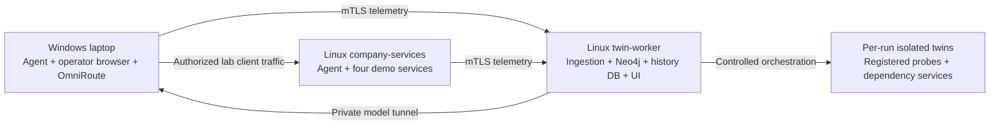

# Mini-company demo lab

Status: deployment blueprint, not a provisioned AWS environment. The current Windows laptop is the operator workstation and Windows discovery host. Two Linux VMs provide the source services and the dedicated sandbox. All accounts, records, and test credentials are synthetic.

## Machines and roles

| Environment | Role | Initial allocation | Components |
| --- | --- | --- | --- |
| Existing Windows laptop | Employee workstation and operator console | Existing hardware | Windows discovery agent as a service, browser, SSH client, existing OmniRoute `lynx-harness` gateway |
| `company-services` Linux VM | Represents the company's service host | x86_64, 2 vCPU, 2 GiB RAM, 20 GB disk | Linux discovery agent as a system service, Nginx, PostgreSQL, Redis, a dedicated lab OpenSSH service |
| `twin-worker` Linux VM | Control plane and dedicated disposable sandbox | x86_64, 2 vCPU, 8 GiB RAM, 80 GB disk for initial sequential runs | Docker Engine/Compose, Python 3.13, host firewall control, ingestion, Neo4j, history PostgreSQL, React dashboard, scheduler, TwinHunter, patch verifier, probe images |

The worker allocation is a starting estimate. Measure readiness, peak use, and contention before increasing concurrency. A 4-vCPU/16-GiB worker is an optional larger allocation if the account and budget permit it. No GPU is required for the OmniRoute model route.

On AWS, `t3.small` and `m7i-flex.large` respectively fit the initial source/worker allocations. These appear in the current new-account Free Tier eligible instance list, but eligibility, regional availability, and remaining credits must be checked in the actual account. Use an x86_64 Linux AMI; the current pinned twin catalog is linux/amd64.

## Four company services

| Service | Company-like purpose | Current pinned twin version | Demo behavior |
| --- | --- | --- | --- |
| Nginx | Intranet landing page / reverse proxy | 1.27.5 | Show configuration synchronization and version-header disclosure enabled/disabled; this is not proof of code execution |
| PostgreSQL | Small employee/inventory database with synthetic rows | 17.2 | Demonstrate ordered `pg_hba.conf` rules and supported authentication/access behavior |
| Redis | Synthetic cache entries | 7.4.2 | Demonstrate unauthenticated access versus synthetic authentication/protection, then verify a candidate fix |
| OpenSSH | Lab administration service with a synthetic account | 9.9p2 | Demonstrate password-authentication policy; password authentication alone is not proof of compromise |

Keep operating-system management SSH separate from the test OpenSSH service. Use the management service for EC2 access and a separate lab configuration/port for demonstrations. Do not weaken management access for a fixture.

Source services must be visible to the current host agent: on Linux it inspects systemd services, host sockets, locally detectable versions, and configured files. Putting source services only inside Docker does not automatically give this agent container inventory or container configuration visibility. During provisioning, verify the actual discovered service names, versions, and config paths. Use `config_files` overrides for nonstandard lab paths. The current version detector must identify the intended service binary correctly, including a separate lab sshd.

Native distribution packages may differ from the pinned twin versions. Matching source versions or adding and testing a new adapter mapping is a provisioning gate for a genuinely synchronized demonstration. An unmatched version remains a visible fidelity gap. The existing pinned fixture suite can still be demonstrated independently, with its source clearly labeled as fixtures.

## Platform components on the worker

- mTLS ingestion and schema/ownership validation.
- Neo4j: hosts, service identities, topology, evidence and candidate paths.
- PostgreSQL: ingestion history, run state, findings, measurements and research reports. This is separate from the company's demonstration PostgreSQL database.
- React dashboard: inventory, telemetry health, path evidence, isolation previews, waves, findings and patch comparisons.
- Scheduler and Docker synthesizer: supported disposable twins and dependency services under explicit CPU/RAM limits.
- Probe containers: bounded Nmap, curated Nuclei and supported service checks.
- TwinHunter control-plane process: calls the model gateway and independently enforces typed tool boundaries.
- Patch verifier: applies candidate changes only to disposable copies and retains checks, diffs and rollback artifacts.

OmniRoute can remain on the laptop. A private SSH reverse tunnel can expose it only on the worker's loopback interface. The worker uses `lynx-harness`; its API key stays in the private worker environment. Testing containers receive neither the model connection nor its credentials.

## Connectivity

These arrows show intended lab communication, not confirmed attack transitions.

Put the two EC2 instances in the same lab VPC and use separate security groups for source services and the worker. Administration is restricted to the operator. Telemetry TCP 8443 is reachable only from the authorized agents. Access the UI/API through SSH forwarding for the initial demo. Bind management database ports to loopback or private container networks; do not use the development Compose port mappings as an unrestricted internet deployment.

Suggested service ports are Nginx 8080, PostgreSQL 5432, Redis 6379, and lab OpenSSH 2222. Connections are allowed only from designated lab clients. The control plane's HTTP API also uses 8080 on its separate machine; the two PostgreSQL roles are likewise on separate hosts.

The Linux worker applies its own per-run host firewall policy before testing. AWS security groups do not replace the workload isolation checks.

## Isolation verification endpoints

For full Phase 2 acceptance, supply three controlled TCP listeners that the worker can reach before sandbox denial tests:

| Category | Placement |
| --- | --- |
| Host | A test listener on a designated non-loopback address of the worker host |
| LAN | A test listener on the source VM's private address |
| Internet | An operator-controlled public endpoint outside the lab VPC; an existing endpoint or a short-lived additional host can serve this role |

The external listener is an additional acceptance-test dependency, not a company application or AI endpoint. Do not claim internet isolation if it is missing or its positive control fails. Configure actual addresses in the destinations file; documentation/example addresses are not test evidence.

## Demo sequence

1. Enroll the Windows and Linux agents with distinct certificates. Show baseline inventory, agent freshness, permissions gaps, and hardware/polling measurements.
2. Edit an allowlisted source configuration and change a disposable listener. Show graph updates, source timestamps and synchronization latency. Disconnect/reconnect an agent and show reconciliation without duplicate identities.
3. Declare entry and critical assets. Inspect candidate routes, missing evidence and the read-only isolation preview. Explain any endpoint-resolution gaps.
4. Start the supported service twins. Show image/snapshot identities, readiness, allowed connections and denied host/LAN/internet controls.
5. Run the secure and vulnerable controls for each adapter. Explain that a policy observation is not automatically a working exploit.
6. Run the existing two-Nginx proxy scenario (`s17`/`s18`) with both dependency services present. This demonstrates the supported multi-service behavior; it does not validate a general website-to-database attack chain.
7. Run TwinHunter against registered twins once Linux isolation and model authentication pass. Show the model identity, complete action trace, executed evidence, and a blocked out-of-scope action.
8. Verify the Redis fix and show the invalid, ineffective, and workflow-breaking patch controls being rejected. Export evidence, metrics and cleanup status.

## Scope of the first demo

The first demo needs the four supported services and the platform components above. A custom company application, Active Directory, Kubernetes, RDS, managed Redis, and cloud IAM analysis are later extensions. Adding those names to the graph would not establish that their behavior or permissions can be reproduced and validated.

The current graph does not automatically join remote socket endpoints to enrolled host identities. A real multi-host attack-path demonstration needs verified endpoint mapping and evidence for each transition. The existing synthetic graph replay is labeled synthetic and cannot be presented as physical-host discovery.

## AWS account and cost facts checked on 2026-10-27

New eligible accounts receive USD 100 of initial credits and can earn up to USD 100 more. The Free plan ends after six months or when credits are exhausted, whichever comes first. Instance availability under a Free plan is limited. This lab is not guaranteed to be permanently free; inspect the account's plan, credits, selected region and estimated compute/storage/network charges before provisioning.

Sources: [EC2 Free Tier eligibility](https://docs.aws.amazon.com/AWSEC2/latest/UserGuide/ec2-free-tier-usage.html), [AWS instance specifications](https://aws.amazon.com/ec2/instance-types/general-purpose/), [AWS Free Tier](https://aws.amazon.com/free/).

Repository references: [adapter catalog](../ingestion/twin_ingestion/phase2/catalog.json), [Phase 1 checks](lab-verification.md), [Linux worker setup](phase2.md), [TwinHunter and benchmark workflow](phase3.md), [path-analysis limits](path-analysis-improvements.md).
