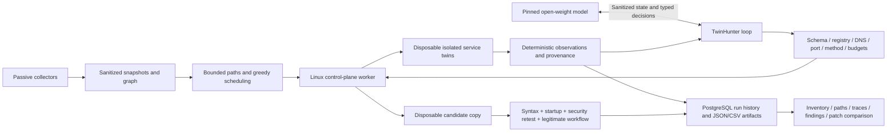

# Phase 3: bounded hunting and research workflow

The implementation is in `ingestion/twin_ingestion/phase3`. The model proposes typed actions; the executor owns target resolution, port and method restrictions, rate limits, process deadlines, step limits, and evidence. Source hosts are never modified. The implementation can be exercised locally with deterministic clients; live AI execution requires the Linux isolation prerequisites from Phase 2.

## Architecture



Only the control plane contacts the model endpoint. Model endpoints receive sanitized configuration and bounded observations. Neither the model nor probe containers receive the Docker socket, host mounts, a general shell tool, arbitrary SQL, arbitrary Nuclei templates, arbitrary URLs, or production patch capabilities. The remote-model adapter accepts HTTPS endpoints; loopback HTTP is allowed for a local model server. Redirects from model endpoints are disabled.

## TwinHunter protocol 3.1

Hunt results carry `protocol: "3.1"`. Compared with earlier runs:

- **Duplicate-action guard.** An action identical to one already executed is not sent again. The trace records it as `blocked` with status `duplicate`, the model receives the earlier observation, and a step is still consumed.
- **Harness control block.** Every model turn includes a trusted `harness_control` object with remaining steps, tokens and seconds, plus the tools already run per target. It is kept separate from `untrusted_twin_state` and `untrusted_tool_observation`.
- **Trace integrity.** `verify_trace()` recomputes the hash chain and reports the first edited, reordered or dropped event. Results include `trace_integrity`.

Because the prompt and loop changed, compare 3.1 runs with earlier ones only as distinct conditions.

## Research insights

`twin_ingestion/phase3/insights.py` derives the following from a report's raw rows. They are returned by `GET /api/research/reports/{id}` and `POST /api/research/insights`, and shown on the console's TwinHunter page.

- Per-method agent behaviour: actions per run, tool usage, blocked reasons, finish status, steps to the first conclusive executed observation, the share of positive predictions backed by executed evidence, and trace integrity.
- Disagreements: scenarios where answering methods split or all answered wrongly. Abstentions and unavailable runs never count as correct.
- Remediation funnel: attempted → original weakness reproduced → original workflow → candidate starts → security retest clean → legitimate workflow → accepted.

Missing traces produce empty behaviour sections; nothing is imputed. The console computes the same values in the browser when the API is unreachable. Hash chains are verified only by the API.

## Tool boundary

`contracts.py` defines the closed action union: configuration inspection, bounded TCP Nmap scan, the single curated Nuclei template, GET/HEAD on `/` or `/health`, TCP connect, PostgreSQL `SELECT 1`, scenario security checks, and indexed candidate configuration edits. Unknown fields are rejected. Each action must name a registered target and its exact port. The executor verifies Docker DNS against the recorded probe-network IP and pins HTTP to that IP. Redirects are checked before a follow-up request; destination, scheme, port and path must remain permitted.

Default limits are 12 decisions/tool calls, 2 requests/second, 5 seconds per probe process, 180 seconds per hunt, 512 output tokens per model decision and a conservative cumulative token reservation of 32,768. UTF-8 message/schema bytes plus protocol overhead conservatively reserve input tokens for the selected byte-level tokenizer; full output allowances are reserved before requests. Reported server usage is recorded separately. A smaller context, step, time or token limit ends a hunt visibly. Patch subprocesses have a maximum 120-second deadline bounded by the remaining hunt time, with label-scoped cleanup on timeout.

Service responses and configuration fields are presented as untrusted data. Prompt instructions are supplementary: the enforced tool schema and executor determine permitted actions even when a model follows malicious text. Boundary tests cover rejected tools, SQL, methods, targets, ports, URLs, redirects, DNS changes, step and token limits. These tests establish the tested boundaries, not universal prompt-injection immunity.

## Model configuration and Google GPU runtime

### Primary model: Gemini 3.8 Flash via OmniRoute

TwinHunter uses **Gemini 3.8 Flash** as its primary model. `TWIN_MODEL_BACKEND` defaults to `omniroute`, and `deploy/models/model-gemini.json` records the condition: requested combo `lynx-harness`, expected upstream `gemini-3.8-flash`, closed provider-managed weights, and a 65,536-token context budget. Every decision records the response model and route decision. If the gateway answers from any model whose name does not contain `gemini-3.8-flash`, the decision is rejected and the hunt records a `model_error`, so failover can never mix another model into these results. Set `TWIN_MODEL_EXPECTED` to change the expected upstream, or to an empty string to accept a deliberately mixed combo (report that as a separate condition). The pinned local Qwen profile below is still available with `TWIN_MODEL_BACKEND=local`.

Because the weights are hosted and can change behind the model name, results from this condition are not weight-pinned. Report the observed response models and run dates alongside any metrics.

Run the 40 agent rows from a Linux sandbox host (WSL2 with Docker Engine is sufficient for development; with WSL mirrored networking, `http://127.0.0.1:20128/v1` reaches OmniRoute on Windows):

```bash
export TWIN_MODEL_API_KEY=...            # never commit or print
PYTHONPATH=ingestion python research/benchmark.py --mode linux_isolated \
  --endpoint http://127.0.0.1:20128/v1 --destinations emulation/destinations.json --repetitions 2
```

TwinHunter can use the OmniRoute combo with API model ID **`lynx-harness`** through the local control-plane gateway. OmniRoute must be configured with upstream provider credentials separately; it does not host a model itself. The user configured round-robin over two accounts serving the same model. A user-run synthetic schema smoke check on 2026-10-26 returned `status: ok`, response model `gemini-3.8-flash-tiered`, `provider=antigravity`, `strategy=round-robin`, and 124 reported tokens. This establishes one compatible response, not a live twin hunt or immutable model weights. The result was supplied by the user and has not been independently reproduced in this process.

In PowerShell, set the gateway key in the current process, then list matching IDs without printing the key:

```powershell
$gatewayKey = Read-Host 'OmniRoute API key' -AsSecureString
$env:TWIN_MODEL_API_KEY = [System.Net.NetworkCredential]::new('', $gatewayKey).Password
$catalog = Invoke-RestMethod -Uri 'http://127.0.0.1:20128/v1/models' -Headers @{ Authorization = "Bearer $env:TWIN_MODEL_API_KEY" }
$catalog.data | Where-Object { $_.id -eq 'lynx-harness' } | Select-Object id, owned_by
```

With the same PowerShell session and API key, run a synthetic structured-output check from the repository root:

```powershell
$env:TWIN_MODEL_BACKEND = 'omniroute'
.\.venv\Scripts\python deploy\models\smoke_omniroute.py
```

This only checks that the combo can return TwinHunter's decision schema. It creates no twin, probe, or security finding.

`lynx-harness` is the default OmniRoute model ID in TwinHunter; `TWIN_MODEL_ID` can override it. On the **Linux isolated worker**, set `TWIN_MODEL_BACKEND=omniroute`, `TWIN_MODEL_ENDPOINT` to a reachable authenticated **HTTPS** gateway URL ending in `/v1`, and `TWIN_MODEL_API_KEY`. Loopback HTTP is accepted only when OmniRoute runs on the same control-plane host. The benchmark runner uses these environment variables and `--endpoint`; an attached Phase 2 wave uses the same variables with `TWIN_HUNTER_ENABLED=1`.

The client requests structured JSON using an OpenAPI-compatible schema because Gemini behind the combo rejected Pydantic's `discriminator`. The original strict Pydantic decision and tool schemas still validate the response before any action executes. The client omits vLLM-specific fields and disables the gateway response cache. The selected upstream must support the JSON request; otherwise the hunt records a model error. Each decision trace records the response model and `X-OmniRoute-Decision` header when supplied. The report labels this as the **primary hosted Gemini condition**, separate from the pinned local Qwen condition. Round-robin across accounts is acceptable for a same-model benchmark if both accounts route to the same model/version with identical inference settings and no fallback to a different model. Record the combo configuration and anonymized account route separately, since the current response header does not identify which account served a request. Disable prompt compression for comparisons. A response model ID alone is not proof of immutable upstream weights.

OmniRoute documents [OpenAI compatibility and combo IDs](https://github.com/cheaper-inference/OmniRoute/wiki/Openai-Compatibility) and [the local endpoint](https://omniroute.cheaperinference.com/).

As a secondary, open-weight condition (`TWIN_MODEL_BACKEND=local`), `deploy/models/model-lock.json` selects **Qwen/Qwen3.8-27B**, revision `1d4bf0f2ff6012fd82039f2fa52739d0dd7c60c0`, BF16, a 16,384-token context, one active sequence, vLLM 0.32.0, and Transformers 5.19.0 for a full A100 80GB. This is an Apache-2.0 open-weight candidate, not a measured claim of the best model for this task. The earlier deterministic report preserves its original Qwen3.5-27B lock as historical provenance. Model quality must be established against the declared benchmarks and simpler baselines. The new runtime profile is unvalidated until an A100 run succeeds.

The [model card](https://huggingface.co/Qwen/Qwen3.8-27B) and [vLLM recipe](https://recipes.vllm.ai/Qwen/Qwen3.8-27B) document serving options and the Transformers requirement. BF16 weights are approximately 52 GiB; cache and framework overhead require additional memory. `serve_model.py` checks for a single mostly free A100 80GB and exact dependency versions. It binds to loopback, requires an API key, and writes a model/runtime manifest. If a smaller GPU is allocated, choose and pin a smaller model or quantization as a separate experimental condition.

[Google's Colab FAQ](https://research.google.com/colaboratory/faq.html) says GPU types and resources vary with availability, including paid plans. A Google AI subscription, Colab compute units, and a reserved Google Cloud GPU are different entitlements; none should be inferred from the word “Pro.” Check `nvidia-smi`. The included notebook supports interactive model setup and a typed-decision smoke check. It does not expose a public model endpoint or give model workloads access to the testing network. For a stable remote control-plane endpoint, use an authenticated HTTPS deployment on infrastructure you control.

In Google Colab, choose **Runtime → Change runtime type → A100 GPU**, open `deploy/models/google-gpu-setup.ipynb` through **File → Upload notebook**, and run the cells in order. The notebook checks GPU memory and disk, installs exact dependencies, loads the pinned revision, makes one constrained typed-decision request, validates its schema and target, and saves `smoke-result.json` plus `model-runtime-manifest.json` for download. The synthetic target in this smoke check is not a security finding. Colab keeps the model server on loopback; it does not supply an HTTPS endpoint to the Linux sandbox worker. The notebook must stay active during inference and Colab can disconnect.

On a separate GPU machine with an authenticated HTTPS control-plane endpoint, in its own Python environment:

```bash
python -m pip install vllm==0.32.0 transformers==5.19.0
# Set TWIN_MODEL_API_KEY through your secret/environment facility.
python deploy/models/serve_model.py
```

On the isolated Linux lab host, after Phase 2 isolation checks pass:

```bash
export PYTHONPATH=ingestion:.
export TWIN_MODEL_ENDPOINT=https://your-authenticated-model-endpoint/v1
# Set the corresponding TWIN_MODEL_API_KEY without committing it.
.venv/bin/python -m research.benchmark --mode linux_isolated \
  --destinations /etc/twin-emulation/destinations.json --repetitions 3 --patches \
  --output research/results/linux-ai
```

For graph-selected live Phase 2 waves, set `TWIN_HUNTER_ENABLED=1`, `TWIN_MODEL_ENDPOINT`, and `TWIN_MODEL_API_KEY` in the Linux worker's environment. `TWIN_HUNTER_RUN_TOKENS` defaults to 65,536 and is capped at 131,072 per emulation run. The worker attaches the hunter to the existing registered target/probe after deterministic prerequisites, retains dependency twins, and stores each trace/evidence/patch result in PostgreSQL `emulation_hunts`. Candidate patch tools are blocked during an active graph wave because the wave has no reservation for extra containers; run patch verification separately using the benchmark workflow. Multi-service candidate patches remain unsupported until dependency workflow checks are implemented. The emulation run dashboard shows these attached hunt records.

The model server must serve the locked name and revision. The client records the requested lock; server deployment manifests are needed to independently attest what weights were served. Repeated seeds do not guarantee bitwise GPU determinism.

### Free Kaggle GPU fallback

When Colab has no suitable GPU, `deploy/models/kaggle-free-t4-setup.ipynb` runs a separate **Qwen3.5-4B FP16** profile on the first GPU of Kaggle's free **T4 x2** option. Import the notebook into Kaggle, select **Settings → Accelerator → GPU T4 x2**, enable Internet for package/model downloads, and run the cells in order. The notebook checks disk and GPU availability, starts a loopback-only vLLM server, validates one typed synthetic decision, and writes `smoke-result.json` and `model-runtime-manifest.json` under `/kaggle/working/twinhunter-model`. This is a small-model experimental condition and must remain separate from the Qwen3.8-27B A100 results. GPU quota and availability can vary. The smoke check does not run the Linux sandbox benchmark.

Kaggle [retired its P100 option in September 2026](https://www.kaggle.com/product-announcements/735239); its T4 x2 option has **16 GB per GPU**, not one shared 32 GB pool. Hugging Face [ZeroGPU](https://huggingface.co/docs/hub/main/spaces-zerogpu) offers shared 96 GB allocations but only a short daily free quota and a Gradio execution model, so it does not provide a stable endpoint for this loop. [Lightning AI](https://lightning.ai/pricing) currently advertises limited introductory GPU credits, including large-memory machines, but the grant and availability must be checked in the account before treating it as free capacity.

## Local reproducibility

Use Python 3.13, the pinned Phase 2 service/probe images, and the repository's virtual environment. Install `research/requirements.txt` for plots. Docker Desktop can run the deterministic fixtures and patch checks; it is explicitly labeled smoke scope and cannot satisfy Linux firewall acceptance.

```powershell
$env:PYTHONPATH='ingestion;.'
.\.venv\Scripts\python -m pip install -r research\requirements.txt
.\.venv\Scripts\python -m pytest -q
.\.venv\Scripts\python -m research.benchmark --mode desktop_smoke --repetitions 2 --patches --output research/results/repeated
.\.venv\Scripts\python -m research.scheduling --mode desktop_smoke --repetitions 3
.\.venv\Scripts\python -m research.analyze research/results/repeated/report.json
.\.venv\Scripts\python -m research.analyze_scheduling
.\.venv\Scripts\python -m research.replay_integration
.\.venv\Scripts\python -m research.cleanup_smoke
.\.venv\Scripts\python -m research.storage_smoke
.\.venv\Scripts\python -m research.provenance research/results/repeated/provenance.json
```

`report.json`, `results.csv`, `ground-truth.json`, generated plots and `results.md` are retained. Runs save after every baseline/scenario so unsuccessful cases remain visible. A missing model endpoint produces explicit unavailable AI rows. ReplayModel is a test double and is never counted as the AI baseline. The optional full-VM comparison is recorded as not run unless a controlled backend and matched hardware are supplied.

`research.cleanup_smoke` verifies exception cleanup and recovery after an abrupt worker-process exit against actual Docker resources. It uses a unique worker label per invocation and reconciles only that invocation's resources. This Desktop check does not assert Linux firewall-rule cleanup. Scheduling plots accept a report path with `python -m research.analyze_scheduling <path/to/scheduling.json>`.

The current local validation has 49 passing Python tests and a successful TypeScript/Vite production build. The corrected benchmark contains 160 rows: 108 completed deterministic/static cases, 12 unsupported cases, and 40 unavailable AI cases. All 18 supported ground-truth fixtures were wire-verified. Four seeded patches accepted the valid fix and rejected the invalid, ineffective and workflow-breaking controls. The attached-loop replay used actual Docker tools, recorded a blocked target and a confirmed supported observation, and cleaned up. A separate disposable PostgreSQL test round-tripped all 160 rows, stored attached hunt traces, collapsed three concurrent identical imports to one report and rejected a conflicting import. These checks do not replace a live model or isolated Linux acceptance run.

Resource comparisons and plots are under `research/results/`; `research/results/README.md` identifies earlier pilots whose CPU totals are lower bounds. Run measurement jobs sequentially to avoid their competing for the same Docker resources. The final source/dependency inventory is captured after validation, with that timing explicitly stated.

Start the existing Compose stack for history and the dashboard. The Phase 3 panel can also open a report JSON directly without database import. It displays method status, independent truth, evidence, source snapshot and image identifiers, AI traces, patches, and rollback downloads. To persist a report, use its authenticated Save action or:

```bash
python -m research.publish research/results/repeated/report.json --api http://127.0.0.1:8080
```

Set `TWIN_EMULATION_API_TOKEN` in the publishing process. Run IDs are immutable; an identical repeat import is idempotent. Inventory and planned/validated paths remain available in the earlier dashboard panels.

## Remediation semantics

Only supported structured edits are accepted. The verifier copies the scenario, starts an original twin and a candidate twin, checks source behavior and a legitimate workflow, verifies candidate syntax/startup, repeats the original security test, and tests the workflow again. It retains the diff, original config/rollback artifact, source and candidate snapshot IDs, image IDs, checks and fidelity limitations. A successful candidate is labeled **verified in the tested twin scenario**. It does not establish production compatibility, zero downtime, or safety of deployment on the source host.

The seeded controls are: Redis synthetic authentication added (valid); Redis invalid protection value (invalid syntax/startup); unchanged Redis exposure (ineffective); PostgreSQL reject-all network authentication (blocks both the security check and legitimate SQL workflow). The latter must be rejected as a regression. Candidate copies use synthetic credentials/data only.

## Remaining acceptance gates

Live pinned-model hunting, stochastic variability, actual model tokens/billing, Linux host/LAN/internet isolation, instrumented-host synchronization/agent overhead and a matched full-VM comparison are not implied by local deterministic success. Missing measurements remain null or explicitly not run. See `research/PROTOCOL.md` and `research/manuscript.md` for experimental definitions and current limitations.
